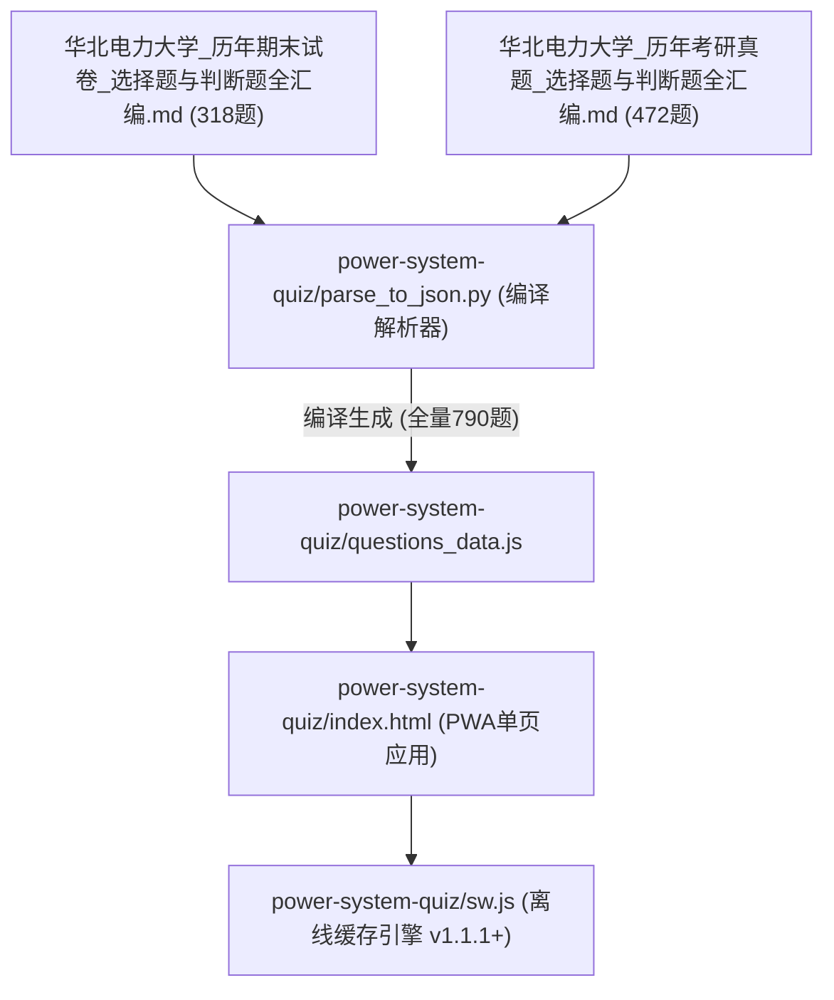

# 🤖 华电《电力系统分析》全真题库系统 Agent 工程维护与避坑实战指南 (AGENTS.md)

> **适用对象**：后续接手、维护、重构本项目的 AI Agents 以及人类工程师。  
> **文档定位**：全真题库数据治理、前端 PWA 交互引擎、数据流防回退机制与高危陷阱复盘的**唯一权威指导书**。  
> **生产地址**：[https://xunyuefei.github.io/power-system-quiz/](https://xunyuefei.github.io/power-system-quiz/)  
> **双仓架构**：  
> - **主工程仓**：`xunyuefei/power-system`（包含完整原始试卷汇编 Markdown、文档站与离线数据流）  
> - **PWA独立仓**：`xunyuefei/power-system-quiz`（纯静态离线单页应用，独立部署于 GitHub Pages 根路径）

---

## 1. 资产拓扑与唯一真理源 (Single Source of Truth)

本项目包含华北电力大学《电力系统分析》历年期末试卷与历年考研真题（共 **790 题**）。题库数据流拓扑如下：



### 🚨 绝对核心原则：源头 Markdown 是唯一的真理源！
* **严禁行为**：任何 Agent **严禁**只通过临时 Python 脚本修改 `questions_data.js`！
* **灾难后果**：若未回填源头 Markdown，一旦未来任何人重新运行 `parse_to_json.py`，未同步源文件的题目会被原版 Markdown 覆盖回退（导致“火哥解析”、“待补充占位符”死灰复燃）！
* **铁律 SOP**：
  1. **先改源头**：题目修改、错别字纠正、公式重写、答案校核必须**首先修改两份汇编 Markdown**；
  2. **再行编译**：运行 `python power-system-quiz/parse_to_json.py` 重新生成 `questions_data.js`；
  3. **质检通过**：运行质检脚本确认 0 异常；
  4. **版本递增**：递增 `sw.js` 的 `CACHE_NAME` 并双仓推送。

---

## 2. 四大典型高危陷阱深度复盘与防御规约

在题库工程演进中，曾暴露出 4 种最隐蔽、破坏力最大的恶性 Bug，后续 Agent 必须严格知晓并遵照防御：

---

### 陷阱 1：单向修补导致“火哥解析/答案待补充”死灰复燃
* **现象**：用户在某天已校对完全部真题，但刷题时部分试卷（如 2021-2022 期末卷）依然显示“原真题未附文字答案（详见视频解析）/ 详见火哥考研视频解析”。
* **根因复盘**：
  1. **数据范围割裂**：上一阶段核验只完成了 472 道考研真题（真题部分“火哥”残留为 0），期末试卷遗留了 44 题未填；
  2. **覆写冲刷**：历史脚本曾直接对 `questions_data.js` 打补丁，但汇编 Markdown 依然写着“火哥占位符”，后续构建直接冲掉了 JS 中的修改。
* **防御规约**：
  - 汇编 Markdown 中**绝对禁止**保留任何模糊占位符。
  - 所有题目的参考答案必须为确定值（如 `A`、`ABD`、`√`、`×`），解析必须包含具体的电力系统物理原理。
  - 每次发布前必须运行检查脚本，确保 `answerPending === false` 且不包含 `火哥` 关键字。

---

### 陷阱 2：前端空值模板拼接引发“选择题冒出判断题对号 `✔️`”
* **现象**：用户在做 4 选项单选题时做错（选了 D），错题档案横幅赫然显示：`标准答案: [ ✔️ ]`！用户严重怀疑选择题被错误匹配了判断题答案。
* **根因复盘**：
  在 `index.html` 错题档案渲染模板中存在如下脆弱代码：
  ```javascript
  // 脆弱代码：当答案为空数组 [] 时，join(', ') 为 ""
  标准答案：<strong class="actual-correct-tag">${correctAnsArray.join(', ')} ✔️</strong>
  ```
  对于未填答案的题目，`${""} ✔️` 被硬编码渲染为单独的绿色 `✔️`！单选题瞬间“变脸”为判断题对号。
* **防御规约**：
  前端 UI 必须具备严格防御性渲染，非空保护：
  ```javascript
  // 健壮防御代码
  标准答案：${correctAnsArray.length > 0 
    ? `<strong class="actual-correct-tag">${correctAnsArray.join(', ')} ✔️</strong>` 
    : `<strong class="user-wrong-tag" style="background:rgba(245,158,11,0.15); border-color:rgba(245,158,11,0.5); color:#fbbf24;">待官方补充 ⏳</strong>`}
  ```

---

### 陷阱 3：粗暴正则与 LaTeX 宏碰撞导致公式撕裂与选项吞并
* **现象**：
  - **公式腰斩撕裂**（如 `2024-816-选择-24`）：选项 A 显示 `$x_{js} = x \frac{S_{`，选项 B 显示 `}}{S_{GN}} B. x_{js} = ...$`，LaTeX 大括号被破坏；
  - **题干文字误切**（如 `2025-815-多选-11`）：题干为“空载电力系统发生 B、C. 相金属性短路”，A、B 选项变空，所有内容挤压在 C 选项中；
  - **大题溢出吞并**（如 `2024-816-选择-30`）：切分正则失效，试卷后续 7 道 15~20 分的计算大题全被吞进选项 D。
* **根因复盘**：
  早期解析脚本使用了过于简单的字符正则（如以 `\bB\.\s` 或 `B.` 作为分割点）。在电力系统分析中：
  1. 经常出现**基准值下标**（如 `$S_{B.}$`），公式中的点号直接触发断句，将公式腰斩；
  2. 经常出现**相别描述**（如 `B、C. 相短路`），被误识别为选项标签；
  3. 变量名包含 `$B'$`、`$B''$`（P-Q 分解法电纳矩阵），误撞选项标记。
* **防御规约**：
  1. **选项边界严格定界**：匹配 Markdown 选项必须包含前缀短横线与加粗标记：`r'\*\*([A-D])\.\*\*\s*(.+)'`，切忌对文本正文模糊搜索 `[A-D]\.`；
  2. **公式内点号清洗**：LaTeX 下标中禁止写 `S_{B. }`，必须规范为 `S_B` 或 `S_{\text{B}}`；
  3. **大题截断隔离**：选择题大题末尾必须显式用 `---` 或 `### 【计算题】` 截断，防止非选择题内容泄露进入最后一个选项。

---

### 陷阱 4：数据合并引发的 Off-by-one 序列位移与跨类型串标
* **现象**：
  - **张冠李戴**（如 `2019 年 815`）：题目选项是“干线式/环式”，解析说明却跳出“我国电力系统额定工频为50Hz”；
  - **跨题型串标**（如 `2020 年 814`）：10 道判断题的答案竟然是 `C, B, A, D...`，解析完全照抄单选题。
* **根因复盘**：
  数据缝合时采用了按行拼接或基于序号顺延的列表批处理，上一道题漏填或索引错移 1 位，导致整套试卷后续所有题目的“考查要点”和“解析说明”发生**系统性顺移（Off-by-one Shift）**！
* **防御规约**：
  1. **基于全局唯一 ID 绑定**：所有数据操作必须使用 `id`（如 `2019-815-选择-02`）作为主键字典检索，**绝对禁止基于列表下标 index 盲目对应**；
  2. **类型强约束校验**：判断题（`type === 'judge'`）答案集合必须属于 `{'√', '×'}`；单选/多选题答案集合必须属于 `{'A', 'B', 'C', 'D'}`，出现交叉即时报错中断。

---

## 3. 全库自动化质量守卫脚本 (Quality Gate)

任何后续 Agent 在执行完题库变动后，**必须在根目录下运行以下质检代码**。只有 5 项检查全为 0 时才允许提交发布！

```python
# -*- coding: utf-8 -*-
"""
题库全量自动化质检脚本 (Quality Gate)
运行方式: python temp_inspect/comprehensive_audit.py
"""
import json, re

with open('power-system-quiz/questions_data.js', 'r', encoding='utf-8') as f:
    text = f.read()

start = text.find('[')
end = text.rfind('];') + 1
db = json.loads(text[start:end])

assert len(db) == 790, f"题目总数异常! 预期 790, 实际 {len(db)}"

# 1. 选项平衡性与公式撕裂检查
broken_options = []
for q in db:
    if q.get('type') != 'judge':
        opts = q.get('options', [])
        if len(opts) < 2:
            broken_options.append((q['id'], '选项数量不足2个'))
        for o in opts:
            t = o.get('text', '')
            if not t.strip():
                broken_options.append((q['id'], f"选项 {o['label']} 内容为空"))
            if t.count('{') != t.count('}'):
                broken_options.append((q['id'], f"选项 {o['label']} LaTeX大括号未闭合"))
            if re.search(r'\b[B-D]\.\s', t):
                broken_options.append((q['id'], f"选项 {o['label']} 疑似泄露下一选项标签"))

# 2. 答案格式与题型冲突检查
ans_anomalies = []
for q in db:
    t = q.get('type')
    ans = q.get('answer', [])
    if not ans or q.get('answerPending'):
        ans_anomalies.append((q['id'], "答案为空或处于pending状态"))
    if t == 'judge':
        if any(a not in ['√', '×'] for a in ans):
            ans_anomalies.append((q['id'], f"判断题混入选择题答案: {ans}"))
    else:
        if any(a in ['√', '×'] for a in ans):
            ans_anomalies.append((q['id'], f"选择题混入判断题答案: {ans}"))

# 3. 占位符残留检查
placeholder_count = sum(1 for q in db if '火哥' in q.get('explanation', '') or '待补充' in q.get('explanation', ''))

print(f"✅ 题目总数: {len(db)}")
print(f"🔍 破损选项数: {len(broken_options)}")
print(f"🔍 答案异常数: {len(ans_anomalies)}")
print(f"🔍 占位符残留数: {placeholder_count}")

assert len(broken_options) == 0, f"发现破损选项: {broken_options}"
assert len(ans_anomalies) == 0, f"发现答案异常: {ans_anomalies}"
assert placeholder_count == 0, "发现占位符残留!"
print("🎉 恭喜！全库质检 100% 通过，可以安全发布！")
```

---

## 4. Agent 维护与发布标准操作规程 (SOP)

当人类用户提出增加新题目、修改解析或更新功能时，请严格遵照以下步骤执行：

### Step 1: 源头修改
- 打开对应的汇编 Markdown：
  - 期末考题：`华北电力大学_历年期末试卷_选择题与判断题全汇编.md`
  - 考研真题：`华北电力大学_历年考研真题_选择题与判断题全汇编.md`
- 遵循统一的 Block 格式，选项必须为标准 Markdown 无序列表，答案为行内代码格式：
  ```markdown
  #### 【题号】`2024-816-选择-24`
  - **所属试卷**：华北电力大学 2024 年硕士生入学考试初试试题 (科目代码：816)
  - **试卷题型**：选择题（第 24 题）
  - **考查要点**：发电机转移电抗换算计算电抗
  - **题目题干**：运用运算曲线查短路电流标幺值时，需要将发电机与短路点之间的转移电抗换算为发电机计算电抗，其换算公式为（）。
    - **A.** $x_{js} = x \frac{S_B}{S_{GN}}$
    - **B.** $x_{js} = x \frac{S_{GN}}{S_B}$
    - **C.** $x_{js} = x \left( \frac{U_{GN}}{U_B} \right)^{2}$
    - **D.** $x_{js} = x \left( \frac{U_B}{U_{GN}} \right)^{2}$
  - **参考答案**：`B`
  - **解析说明**：发电机计算电抗等于以发电机额定容量为基准值的转移电抗标幺值，公式为 **$x_{js} = x \frac{S_{GN}}{S_B}$**。
  - **校核状态**：【已核定】
  ```

### Step 2: 管道编译
在根目录运行编译命令：
```powershell
python power-system-quiz/parse_to_json.py
```
终端必须输出 `Verified: 790, Answer pending: 0`。

### Step 3: 执行质量守卫
运行自动化质检脚本，确保 3 个异常指标全部为 0。

### Step 4: 递增 Service Worker 离线缓存版本
修改 `power-system-quiz/sw.js` 第 6 行：
```javascript
const CACHE_NAME = 'ncepu-quiz-pwa-v1.1.2'; // 递增小版本号，确保所有客户端离线缓存自动刷新
```

### Step 5: 双仓库提交与发布 (Git Push)
本项目为主仓与子独立仓双仓拓扑，必须分别执行推送：

1. **推送独立刷题宝仓库（触发 Pages 构建发布）**：
   ```powershell
   cd power-system-quiz
   git add index.html parse_to_json.py questions_data.js sw.js AGENTS.md
   git commit -m "fix/feat: <更新简述>"
   git push origin main
   cd ..
   ```
2. **推送主工程仓库（保留文档与原始汇编历史）**：
   ```powershell
   git add "华北电力大学_历年期末试卷_选择题与判断题全汇编.md" "华北电力大学_历年考研真题_选择题与判断题全汇编.md" power-system-quiz/ AGENTS.md
   git commit -m "docs/feat: <更新简述>"
   git push origin main
   ```
3. **验证 GitHub Actions 状态**：
   通过 API 确认 `Deploy Quiz PWA to GitHub Pages` 状态为 `completed` 且 `success`。
